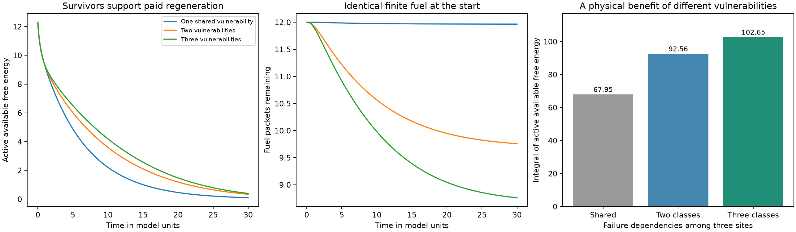

# Response Diversity and Physically Funded Regeneration

Conditional physical results for the Entropy Paradox, 21 October 2026

Differently vulnerable capacities can maintain more active organization from the same finite fuel inventory because a surviving capacity can rebuild a damaged partner. Sharing makes repair possible; retained differences prevent one event from disabling every repairer. A further copying model produces a new realized response type from a single ancestral type, through errors that consume monomers and fuel. These constructions exhibit advantages in actual nonequilibrium available free energy, with no reward for biodiversity or group formation.

The results concern continuing regeneration under declared physical conditions. The copying model supplies a finite alphabet of possible variants, rather than an initially diversified population. Contacts, repair, and copying variation are established in separate constructions. Integrating them into one chemistry that forms new collective lineages and repeats the transition across organizational levels remains the generative problem to solve.

## Persistence is a temporal property

When productive capacity multiplies across periods, its realized long-run growth depends on the mean of its logarithmic multipliers. Averaging the multipliers first can hide decline or irreversible failure. Taleb's treatment of ruin and path dependence identifies this distinction; his discussion of portfolio pseudo-stabilization also explains why fat tails can require broader diversification than Gaussian intuition suggests. [Statistical Consequences of Fat Tails section 3.11](https://arxiv.org/pdf/2001.10488v4#page=77), [section 8.5.1](https://arxiv.org/pdf/2001.10488v4#page=176)

Independent responses can change a severe simultaneous-loss probability from p to p raised to the number of responses. The earlier Pareto log-loss construction makes this exact: the minimum of n independent severities has tail exponent n times the individual exponent. Under sufficient production, that can change divergent negative logarithmic growth into finite positive growth. These are response channels, not interchangeable species labels. A common catastrophic exposure defeats the independence advantage.

Ecological insurance supplies a corresponding biological hypothesis: different organisms can maintain functions under different conditions. Its strength depends on their responses and interactions. [Yachi and Loreau](https://pmc.ncbi.nlm.nih.gov/articles/PMC15485/)

Probability of continuation alone is insufficient. If a fixed stock is divided among independent pieces that never repair or reproduce, the last piece can survive longer without increasing expected total stock integrated through time. Physical regeneration is the missing operation.

## An exact result with a finite fuel stock

Take two labeled active chemical sites, each storing energy epsilon above its inactive state. Each active site has marginal damage rate lambda. A surviving site can catalyze repair of the other at rate mu, consuming one fuel packet. There are K packets initially, each with usable energy gap e greater than epsilon. This strict inequality also makes reverse repair vanish in the low-temperature limit used below. Inactive material retains its template. Repair takes a random positive time; the last survivor can fail before completing it.

Compare a common vulnerability, where one event disables both sites, with independent vulnerabilities of identical per-site damage rate. In the irreversible limiting model, zero activity ends the episode. With no repair, both arrangements have the same expected integrated active energy, 2 epsilon divided by lambda.

For constant repair rate, define rho = mu divided by the sum of lambda and mu. Starting with both sites active:

```text
V_K = E[integral_0^first_total_inactivity epsilon * active_site_count dt]

V_K(independent) = (epsilon/lambda) [2 + sum_j=1..K rho^j]
V_K(common)      = 2 epsilon/lambda

E[successful repairs] = sum_j=1..K rho^j
```

The result follows from waiting for damage in the two-active state and then racing repair against loss of the one remaining active site. Every successful repair consumes a packet before the system returns to the two-active state with one fewer packet. There is no resetting operation.

For epsilon = lambda = mu = 1, e = 2, and K = 3, independent vulnerabilities yield 2.875 units of integrated active energy, versus 2 for the common vulnerability. The expected number of repairs is 0.875. Expected heat delivered to the bath by the episode endpoint is 3.75, and expected unused fuel energy is 4.25. The initial energy was 8, so the first-law inventory closes.

More generally, if R repairs occur, repair dissipates e minus epsilon per event and subsequent damage releases the restored epsilon. Thus:

```text
heat to bath = 2 epsilon + e R
unused fuel energy = e (K-R)
initial energy = heat + unused fuel energy
```

With mass-action repair, the rate falls as fuel is depleted. The exact recurrence still applies with a fuel-dependent rho; descending products replace its powers. The advantage does not depend on a freely replenished reservoir.

## Available free energy rather than an energy label

Stored active energy is a useful observable, but it omits entropy. For a finite stochastic system with probability distribution p and thermal reference pi, the nonequilibrium available free energy is:

```text
B(p) = theta sum_s p_s log(p_s/pi_s)
theta = k_B T
```

This is free energy above the declared equilibrium reference. Its energy and entropy contributions must be retained. Thermodynamics of stochastic chemical networks supplies the appropriate trajectory energy, entropy and chemical-work balances. [Schmiedl and Seifert](https://arxiv.org/abs/cond-mat/0605080), [Rao and Esposito](https://arxiv.org/abs/1602.07257)

The finite-temperature version retains reverse repair and rare thermal reactivation. In the two-site example, at theta = 0.05 and horizon 4, the integral of actual active-subsystem availability is approximately 2.5046 for independent vulnerabilities and 1.8866 for the common vulnerability. Both use the same Gibbs reference. This is an available-free-energy result, not merely a relabeling of active energy.

An analytic bound also preserves its positive sign. The active-state entropy difference can change the comparison by at most theta times the horizon times log 4. A finite-matrix perturbation bound controls the additional effect of thermal reverse rates. At theta = 0.05 these corrections leave a positive lower bound of 0.4555, compared with a directly integrated availability advantage of 0.6180. The calculation evaluates the bound numerically; it is not an interval-arithmetic certificate.

Thermal reactivation makes total inactivity recoverable in principle. First inactivity is therefore an episode endpoint in this model, not proof of permanent biological extinction.

## Reversible contacts and physical repair

A second construction includes three sites and three possible pairwise contacts. Sites switch between active and inactive states. Contacts bind and unbind through ordinary energetic interactions. All systems begin with three active sites, zero contacts and twelve fuel packets. Their total number of sites and fuel-plus-waste molecules remains fixed.

The active subsystem energy is:

```text
H_A = epsilon * number_active
      + E_contact * number_contacts
      - J * number_contacts_between_active_sites
```

A contact between active sites is energetically favored for the parameters used. An inactive partner changes its contact energies. Contacts are therefore dynamical states; no group count or preferred group membership drives their formation.

An active site can repair an inactive contacted partner through a fuel-consuming reversible reaction:

```text
inactive_j + active_i + fuel
    <-> active_j + active_i + waste
```

Contacts also permit damaged neighbors to catalyze inactivation. Repair and damage compete through the same physical neighborhood. The interface has consequences for both assistance and failure propagation.

The full state records activity, contacts, remaining fuel and a reversible environmental gate. Fuel and waste have a finite combinatorial mixing entropy. Every transition pair obeys local detailed balance with respect to the same mesoscopic free-energy function:

```text
Phi = H_A + E_fuel * fuel_count
      - theta log[binomial(K, fuel_count)]

q(s -> s') / q(s' -> s) = exp[-(Phi(s')-Phi(s))/theta]
```

The environmental gate has degenerate well energies and changes only kinetic prefactors; its transitions are included in the joint reversible generator. No prescribed external energy injection is used in this finite model. Barrier-only gating is a coarse physical idealization, rather than an identified molecular apparatus.

The system is closed to matter and coupled to a thermal bath. Its total available free energy decreases while fuel can be transferred into renewed active organization. A chemically closed finite reservoir need not be treated as an inexhaustible faucet; open chemical behavior can also emerge as an approximation when reservoir abundance and timescales separate. [Remlein, Esposito and Avanzini](https://arxiv.org/abs/2604.14848)

## Matched physical comparison

The three sites can share one vulnerability or possess two or three vulnerability classes. Each class has the same collective-denaturation rate, so every active site has the same forward shock hazard from this channel. Rare thermal reversals of those channels are retained. What changes is which sites fail together.

The comparison uses theta = 0.4, active energy 4 per site, fuel energy 7 per packet, contact permeability 3 and horizon 30 in normalized model units. All arrangements start with total available free energy 96.3024 and active-subsystem availability 12.3024. No new fuel enters.

| Vulnerability classes among three sites | Active availability integrated through time | Active sites integrated through time | Fuel packets consumed |
| --- | --- | --- | --- |
| One shared vulnerability | 67.9511 | 19.6844 | 0.0353 |
| Two vulnerabilities | 92.5611 | 27.9911 | 2.2419 |
| Three vulnerabilities | 102.6467 | 31.2866 | 3.2389 |

Three vulnerability classes retain 51.06 percent more active availability integrated through time and 58.94 percent more active function than one shared vulnerability. These are energy-times-time and site-times-time comparisons over the declared horizon, not claims of additional total energy or extracted work. The diverse arrangement deploys fuel for repair that the common failure leaves largely stranded.

The availability calculation uses the evolving marginal distribution of activity and contacts, not a species-count score. The common equilibrium reference factors into active, fuel and environmental marginals. Total availability equals the marginal availabilities plus their nonnegative correlation contribution. The code retains this separation rather than calling all unused fuel living organization.



The finite Markov generator has 1,664 states. Transition-pair log-ratio errors are below 0.00000000000003. Numerical refinement from 481 to 1,921 observation times changes each availability integral by less than 0.005 percent. Fuel conversion is checked both directly in the generator and through integrated repair flux. The illustrative numerical values are not measured biological constants.

## A chemical transport and regrowth realization

A separate concentration model replaces active-site bookkeeping with two alternative assembly chemistries in equal-volume patches. Each uses reversible association of A_i and B_i into C_i; C_i catalyzes fuel conversion into further components. A family-specific kinetic suppression can drive its resident population below the establishment basin.

After the disturbance, a fixed interval of reciprocal passive diffusion transfers actual molecules from a surviving patch into the depleted patch. Donor material is depleted by that transfer. Continuing matched feed supports renewed production and assembly. There are no replacement seeds.

At horizon 120, integrated assembled C is 318.2655 for the initially diverse arrangement, compared with 192.3093 for the equal-prior mean of the two monocultures. That is a 65.50 percent gain. Initial volume, material, standard energy, chemical free energy and assembled inventory match. Removing transport makes the two ensemble means equal to numerical precision. Physical recolonization supplies the additional benefit.

This model demonstrates transport and regrowth, not another active-availability theorem. Raw reactor free energy can be higher after washout because high-energy feed accumulates unconsumed. Its diffusion schedule, patch geometry and response chemistry are prescribed environmental conditions. They do not establish autonomous boundary control.

## Why partial coupling can be favored

The benefit of sharing and the risk of shared failure can produce a finite preferred coupling without assigning a reward to groups. An exact one-packet renewal model makes this conditional result explicit.

Let coupling g enable repair at rate alpha g and introduce an additional common failure hazard gamma g. Independent per-site damage remains lambda. For one available packet:

```text
L = lambda + gamma g
p = 2 lambda / (2 lambda + gamma g)
rho = alpha g / [lambda + (gamma+alpha)g]

V(g) = (epsilon/L) [2 + p rho]
V'(0) = epsilon (alpha - 2 gamma) / lambda^2
```

For positive lambda and gamma, if alpha exceeds twice gamma, some positive coupling improves integrated active energy over isolation. If g can range over all nonnegative values, the common failure hazard drives this quantity toward zero as coupling becomes arbitrarily large. Continuity therefore gives an interior optimum. A physically restricted interval must be checked separately; the initial slope alone cannot establish an interior optimum within every allowed range. The source of the optimum is finite-time paid repair competing with contagion, not a penalty assigned to excessive group size.

For lambda = gamma = epsilon = 1 and alpha = 4, the unique optimum is g = 0.0681672. Its integrated active energy is 2.05647, compared with 2 in isolation and 1.22222 at g = 1. Every case begins with two sites and one fuel packet; exact generator calculations reproduce the formula and close the fuel and heat ledgers.

This is a conditional performance landscape. It does not establish that evolution discovers its optimum. Nor is it the same as observing an optimum in every microscopic contact model: the three-site contact scan retained regimes where increased coupling helped throughout the tested range and regimes where isolation was preferable.

## A new realized response type from one ancestor

The next construction begins with one ancestral replicator R0, five free monomers D, twelve fuel molecules F, no waste, and no alternative replicator. Copying can produce the ancestral response or a variant R1 through a chemical error:

```text
D + F + R_i <-> R_i + R_j + W
```

The parent is a catalyst. Each product consumes a monomer and fuel molecule. A copying kernel mu_ij assigns the fraction of products of type j made using parent i, with each row summing to one. Total forward copying propensity is therefore independent of the error rate at a fixed physical state. There is no extra production allowance for variation.

The propensities are:

```text
a_forward(i,j) = kappa mu_ij D F R_i
a_reverse(i,j) = kappa mu_ij exp[-(E_fuel-epsilon)/theta]
                 * W R_i (R_j-delta_ij)
```

The same-type correction prevents a replicator from serving as both catalyst and removed product. Both directions contain the same copying coefficient. Their ratio satisfies local detailed balance with the multinomial Gibbs free energy of monomers, replicators, fuel and waste.

The two controls share the same possible species, equilibrium reference and monomorphic initial state. One copies without errors; the other has error probability 0.2. Passive thermal formation and the rare reverses of collective damage remain present in both. A separate first-appearance calculation identifies whether the new allele arose from an actual erroneous copy or a thermal reverse event.

At horizon 8, with six conserved material units and twelve conserved fuel-plus-waste molecules, template energy is 0.8, fuel energy 1.2, theta 0.05, copying coefficient 0.04, passive decay rate 0.03 and collective shock rate 0.2 per response class:

| Observable | No copying errors | Error probability 0.2 |
| --- | --- | --- |
| Final material-subsystem availability | 0.9003 | 1.3130 |
| Material availability integrated through time | 14.3717 | 16.2708 |
| Probability some replicator remains | 0.1994 | 0.3557 |
| Expected replicator count | 1.1655 | 1.7785 |

The probability that the first new allele appears through paid copying is approximately 0.5861; the combined probability of first appearance through thermal channels is below 0.0000005. The alternative is produced by replication, rather than supplied as an external replacement seed or restored mixture.

The causal loop is now replication, copying variation, differentiated survival, and further replication by survivors. Final material availability rises by 45.84 percent and its integral by 13.21 percent in this comparison. Total closed-system availability still decreases: it begins at 15.1104 in both controls and ends at 9.5583 without errors and 8.3186 with errors. The variation-enabled system spends more of its fuel while retaining more availability in replicating material.

The final availability advantage of 0.4127 consists of a 0.4904 increase in stored active energy minus a 0.0777 entropy contribution. This entropy includes uncertainty over count states and their multinomial configurational degeneracy. The gain survives that entropy cost. Extra names or sequence uncertainty are not counted as extra order. Probability of some replicator at the final observation is not a probability of uninterrupted survival: thermal reactivation remains possible.

Common-mode destruction removes the advantage: final material availability becomes approximately 0.9003 without errors and 0.8687 with errors. Without shocks, errors also lower final material availability despite nearly identical replicator counts. More sequence uncertainty is therefore not being counted as extra thermodynamic order. Removing fuel or leaving only one material unit prevents copying and makes the error-rate controls coincide.

Increasing the possible alphabet to three or four variants also does not monotonically improve integrated availability in the tested regime. Each alphabet is evaluated against its own matched error-free control and equilibrium reference. These comparisons do not establish a maximum at unlimited diversity.

The available alphabet and its vulnerability map remain physical premises. Copying errors realize another response within that alphabet; they do not invent an unlimited molecular grammar. Collective all-of-type denaturation is represented by a reversible aggregate Markov channel with the required factorial reverse rate. It is not an elementary dilute mass-action reaction of fixed order. This construction has copying and a realized new response, but no compartments or collective reproduction.

These finite-state physical comparisons use finite-rate damage channels rather than an unbounded fat-tail process. They establish the paid-regeneration bridge motivated by the earlier tail calculation. They do not yet demonstrate its full heavy-tail scaling in the same molecular model.

## Adverse cases and the remaining generative step

Distinct responses are useful only when some capacity remains available for repair and when the resources and interfaces can support it. Common-mode disturbance defeats all alternatives. Repair can be too slow, and transport can dilute founders below their establishment threshold. In the concentration model, indiscriminate mixing at lower feed destroys the diverse arrangement even without the targeted disturbance.

A different reversible environmental-gating regime in the three-site model also favors the monoculture: its active-availability integral is 45.5135, versus 43.6586 for two response classes. This rules out treating the favorable comparison as a universal biodiversity optimum. Low contagion can favor greater exchange, while high contagion can make separation advantageous.

The physical results support two connected loops. Differentiated survival preserves a repairer; contacts permit fuel-funded restoration; restored capacity contributes to subsequent maintenance. Copying also generates a new realized response, which can preserve further copying under different losses. Actual contact assembly and copying variation occur without a group or diversity reward, although their possible chemistry is specified.

The next generative test must integrate copying variation with the contact and transport mechanisms, determine whether assemblies inherit collective traits, and establish whether a new collective can generate a further level of organization without a fresh reproduction rule supplied at each level. Persistence of a copying variant does not yet establish a new collective individual.

Ordinary stationary action alone does not select a biodiversity optimum. A physical derivation must include interactions, reservoirs or finite resource stocks, environmental histories and the kinetics of variation, repair and reproduction. The results here advance the conditional thermodynamic mechanism while leaving recursive individuation and cosmic necessity open.

## Reproducible calculations

Models and numerical results (archive omitted) contains the finite-fuel renewal proof checks, reversible contact model, transport and regrowth model, copying model, retained adverse cases, refinement checks and run instructions. The scripts measure availability and function after integrating the dynamics; none uses these measurements as a reward or transition rule.
