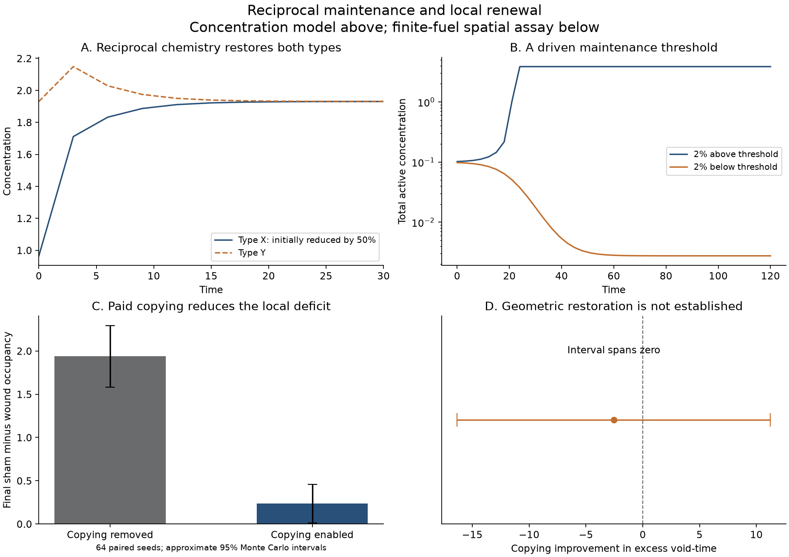

# Metabolic Integrity and Collective Individuation

The proposed criterion is that a candidate collective maintains the processes and interfaces that let its components continue as distinguishable units. Its integrity is a pattern of activity through time: damaged capacities are renewed, resources continue to reach their users, and the organization survives some replacement of its material. The next physical question is whether this pattern acquires a stable, causally effective organization at a larger scale.

Two conditional constructions now establish parts of that mechanism. Local copying responds to template inactivation without a wound detector. A separate reversible chemical network has a threshold between low activity and sustained reciprocal maintenance. Neither construction yet produces an organism's maintained outer boundary or nested individuals.

## The distinctions an individuation model must preserve

Contact, reproduction, self-maintenance and agency answer different questions.

| Property | What would support it |
| --- | --- |
| Cohesive assembly | Persistent contacts or an interface |
| Physiological integrity | Processes causally renew the conditions of continued organization |
| Evolutionary individuality | Heritable variation and differential reproduction at the proposed level |
| Collective agency | Joint predictions, actions and corrections produce persistent, revisable dispositions |

These properties can overlap without arriving together. A sterile organism can maintain itself. A crystal can be cohesive. An ecological community can contain reciprocal dependencies without thereby becoming one organism. A threshold in one chemical reaction is therefore not a universal definition of individuality.

Existing theory already addresses these distinctions. Queller and Strassmann analyze organismality through cooperation and conflict; Godfrey-Smith examines reproductive individuality, including growing and splitting herds. Krakauer and colleagues supply quantitative measures of continuity through time, explicitly including distributed and cultural systems. The remaining ambition is to connect recognition criteria with physical formation and maintenance across scales. [Queller and Strassmann](https://pmc.ncbi.nlm.nih.gov/articles/PMC2781869/), [Godfrey-Smith](https://www.petergodfreysmith.com/Dpops_PGS_Sample_Chapter_4.pdf), [Krakauer and colleagues](https://link.springer.com/article/10.1007/s12064-020-00313-7)

Wilson and Sober also explicitly address groups as functionally organized superorganisms. Multilevel selection is relevant to the origin of organismality; it should not be dismissed as unable to discuss it. A particular selection analysis still needs to establish how its proposed units are formed and maintained. [Wilson and Sober](https://pubmed.ncbi.nlm.nih.gov/2811397/)

## Boundaries and reciprocal maintenance

A Markov blanket expresses conditional independence: given the blanket variables, an internal state supplies no additional information about an external state. It permits interaction through an interface; it does not imply that the components are energetically self-sufficient. Statistical screening alone also does not show that an interface is produced, repaired or controlled by the system.

Nested-blanket models already exist. Palacios and colleagues simulate hierarchical assembly using suitable generative priors that specify conditional dependencies at each level. The origin of those priors remains an additional question, and their variational free energy is informational. Explicit chemical-work accounting supplies a different kind of evidence. [Palacios and colleagues](https://discovery.ucl.ac.uk/id/eprint/10089189/1/Friston_1-s2.0-S0022519319304588-main.pdf)

The closest organizational framework is closure of constraints: processes support structures that channel other processes, which in turn help maintain those structures. Thermodynamic openness is compatible with this mutual dependence. The framework also distinguishes relatively conserved constraints from the processes they channel; a growing catalytic population is not automatically a demonstrated constraint in that technical sense. [Montévil and Mossio](https://montevil.org/publications/articles/2015-mm-organisation-closure-constraints/)

For nested individuation, the proposed additional condition is reciprocal maintenance across interfaces. Components help reproduce a larger distribution and coordination system; that system helps reproduce the conditions under which the components continue their own distinct activity. Neither arbitrary nesting in a diagram nor an observed correlation establishes this return path.

## A physical threshold for reciprocal maintenance

Consider two catalytic types, X and Y, a conserved precursor D, fuel F and waste W. Each type participates in replacing the other through reversible reactions:

```text
X + Y + D + F <-> 2X + Y + W
X + Y + D + F <-> X + 2Y + W

X <-> D
Y <-> D
```

The catalytic grammar is supplied. No fitness score, preferred group size or reward for cooperation enters a rate. Fuel and waste are maintained by reservoirs, and their chemical work is counted. This is a concentration model with total material concentration N, rather than a system containing N individual molecules.

Let q = k_forward f and r = k_reverse w. Thermodynamic consistency requires k_reverse = k_forward exp[-(e-epsilon)/theta] and thermal formation eta = delta exp[-epsilon/theta]. The deterministic equations are:

```text
D = N-x-y
dx/dt = q x y D - r x^2 y - delta x + eta D
dy/dt = q x y D - r x y^2 - delta y + eta D
```

The difference obeys an exact restoring law:

```text
d(x-y)/dt = -(delta + r x y)(x-y)
```

Every stationary state is therefore symmetric. On x=y=u, the full finite-temperature dynamics reduce to:

```text
du/dt = eta N - (delta+2 eta)u + (qN)u^2 - (2q+r)u^3
```

At N=4, epsilon=4, e=6, theta=0.5, k_forward=f=w=1 and delta=0.2, the physical reverse reactions and thermal source remain present:

| Concentration of each type | Dynamical role |
| --- | --- |
| 0.00137893 | Stable low activity |
| 0.04994922 | Unstable threshold along the symmetric direction |
| 1.93052242 | Stable sustained activity |

Symmetric starting states just below and above the middle value approach different stable states. Tested losses of 25 percent of both types or 50 percent of one type recover to the high state. These are conditioned starting states with lost active material retained as D; their preparation energy change is recorded. The post-preparation trajectories pay for recovery through fuel conversion.

Removing either reciprocal reaction pair, forward and reverse together, destroys high maintenance for these parameters. Removing the fuel chemical-potential difference gives a single equilibrium and monotonically decreasing material free energy. Thus the high branch depends on driven reciprocal chemistry.

At that high state, maintained material availability density is 13.80569 in normalized units: the ideal material mixture's G minus its equilibrium minimum at fixed N, excluding reservoirs. Chemical power density is 4.63314, balanced by dissipation. The continuing reservoir work is essential: conserved material does not make the energy supply finite. These quantities include ideal mixing entropy. Random-state identities and nine trajectory ledgers verify reaction affinities, material conservation and the free-energy/work balance.

The result is a threshold of reciprocal metabolic maintenance. Similar bistability can occur in cooperative single-species chemistry. It supplies no membrane or constituent autonomy, and does not establish an individual by itself. In a finite molecular system, noise can induce switching between long-lived regimes; deterministic bistability is not two permanent stationary probability measures.

## Local renewal after damage

A separate spatial assay retains the existing attraction, transport, copying and passive decay rules. Four internal templates become precursor through allowed decay events. No matter leaves and no fuel is consumed in that preparation; the conversions release 23.2 units of stored energy as heat. Selection or preparation of the damaged state is outside the autonomous dynamics being tested.

The lesion creates eight contacts between surviving catalysts and available precursor. Its initial local paid-copying propensity rises from zero to 8k=0.16. The material configuration itself activates replacement; no rate checks whether the system has been wounded.

Sixty-four replicate seeds per condition compare intact and wounded assemblies, with copying enabled or with both copying directions removed. The energy function and initial state match across the copying comparison within each injury condition. The wounded and intact states intentionally have different stored energies.

After accounting for each condition's intact behavior, copying reduces the final deficit at the four damaged sites by 1.7031 occupied sites, with Monte Carlo standard error 0.2121. It reduces the whole active-inventory deficit by 2.0313 templates, standard error 0.7862. Independent replay verifies all 67,553 events, fuel conversions and energy accounts.

The stronger geometric result is absent: the copying improvement in excess enclosed-void time is -2.55 with standard error 7.03. Occupant tags identify birth provenance but cannot distinguish in-place copying from copies transported into the damaged region. Ordinary growth into newly available precursor can explain the renewal result. This assay establishes a causal replacement mechanism, not a maintained shape, a Markov blanket or a higher individual.



## What scaling can explain after a collective forms

West, Brown and Enquist's network model derives allometry using assumptions about resource-distribution geometry, transport costs and terminal units. Their growth model allocates metabolic energy between existing tissue and new biomass. The identified organism is part of that starting description. A schematic energy allocation is:

```text
cost_per_new_mass * dM/dt = metabolic_supply(M) - maintenance(M)
```

These mechanisms can constrain how an organized unit grows; they do not identify which initially unbound constituents become that unit. [West, Brown and Enquist 1997](https://doi.org/10.1126/science.276.5309.122), [West, Brown and Enquist 2001](https://www.nature.com/articles/35098076)

Power-law allometry, a scale-free network degree distribution and a heavy-tailed recovery time are different claims. Their exponents cannot be substituted for one another. Urban scaling also separates infrastructure, individual requirements and social outputs rather than assigning everything the biological exponent. [Bettencourt and colleagues](https://doi.org/10.1073/pnas.0610172104)

The proposed sequence is formation, causal integrity, then scaling measurement. Internal transfers must cancel in the collective's resource balance, so nesting cannot create an additional fuel supply through bookkeeping. Neither a favorable exponent nor transport efficiency establishes preserved constituent agency.

## Symbolic coordination as a causal layer

At cultural scales, a selective interface may be implemented by maintained roles, permissions, records, commitments and authority rather than by a continuous membrane. These practices matter when they change who performs work, receives support, controls resources or revises a shared course of action. Their physical implementation remains essential, while their causal role depends on how participants interpret and act on them.

A constitution or shared account is therefore insufficient by itself. Its interpretation and revision must return to conduct. The Group Mind essay already proposes this loop: a collective predicts and acts; members answer independently; the shared account changes; subsequent attention, work, support or repair changes with it. The account's persistence is weaker evidence than that consequential return path.

A discriminating cultural test would preserve communication volume and accounting costs while interrupting the relevant routing or correction mechanism. Does coordinated maintenance fail despite the same participants and messages? Can participants restore it? Do their different answers remain capable of changing collective action? This is a proposed intervention, not a claim that the chemical experiments demonstrate institutional agency.

Human groups can overlap and have several legitimate boundaries at different timescales. The question is which boundary supports a particular continuing organization. A sharp universal membership threshold is unnecessary, but the causal effect of the proposed organization must be measurable. Evolutionary group benefits and symbolic organization have their own prior literature. [Smaldino](https://doi.org/10.1017/S0140525X13001544)

## The next physical test

The missing connection is a boundary that participates in reciprocal maintenance: internal processes produce or repair interface material; the interface selectively sustains those processes; removing either direction undermines persistence under matched resource inputs. A persistent outer organization must then coexist with measurable lower-level processes and interfaces. Repeated reproduction and inherited collective variation are further tests.

This extends the existing diversity argument. Differentiated capacities can keep rebuilding possible, while maintained interfaces can let exchange occur without making every failure shared. A new collective would be supported when that pattern of exchange and containment is itself generated and maintained. The current experiments establish local renewal and a reciprocal-maintenance threshold. They leave that boundary-producing transition, recursive individuation and a cosmic necessity open.

Models and verification data (archive omitted) contains the two experiments, thermodynamic and trajectory checks, source notes and run instructions.
